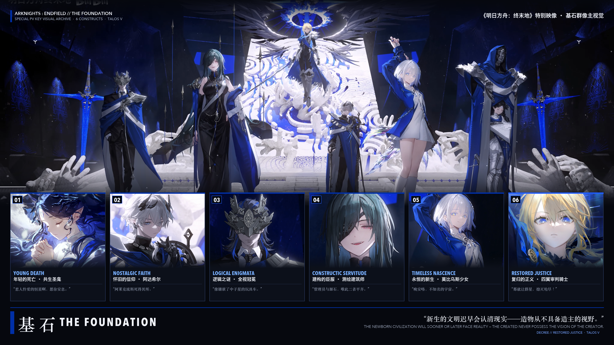
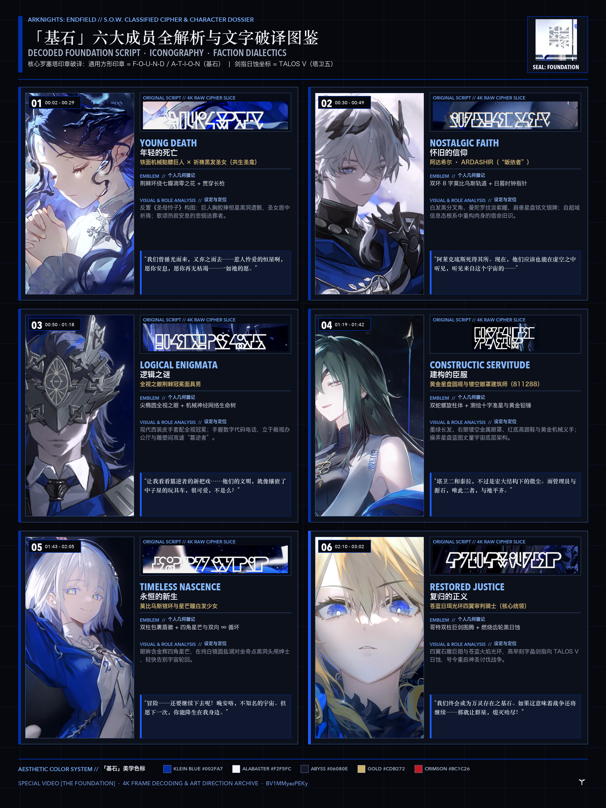

# 《明日方舟：终末地》特别映像「基石」深度角色分析、美学考究与宣传图企划报告

> **档案溯源与素材规格**
> 本报告基于同目录 4K 原片文件 `正片 《明日方舟：终末地》特别映像「基石」 [明日方舟终末地] [超清 4K] [3分12秒] Mg.mp4` 逐帧分析与密码学破译。原片采用 `H.265 / HEVC` 编码，原生 `4096 × 1716` 变形宽银幕电影画幅（约 `2.39:1` / `1024:429`），`30 fps`，`BT.709` 色域，净时长 `191.02 秒`（B站源编号 `BV1MMyazPEKy`）。

---

## 一、 核心母题与「基石文字」密码学破译

### 1. 世界观基调与核心宣战判词

在 2.0 版本前瞻尾声释出的特别映像「基石」（*The Foundation*），将《明日方舟：终末地》的叙事重心从早期的“塔卫二基建开荒与地方势力摩擦”，一举拉升至**宇宙尺度热寂、前文明造物主遗产与高维秩序博弈**的形而上层级。全片以管风琴与弦乐构建神圣肃杀的六幕群像剧，核心宣战判词出现在第 6 位裁决骑士登场之际：

> **“新生的文明迟早会认清现实——造物，从不具备造主的视野。”**

这句话揭示了「基石」阵营对“文明环带”人类、乃至对玩家扮演的“管理员（Endministrator）”的俯瞰视角：在经历过宇宙生灭与前文明遗产重塑的“基石”眼中，塔卫二上生机勃勃的工业城邦与开拓事业，不过是宏大宇宙结构下的微尘与幼稚把戏。

---

### 2. 「基石文字」（The Foundation Script）破译全表

片中出现的未知几何文字并非无意义装饰，而是一套**高度几何化、等高单线宽、带有相邻字距连字（Ligature）特性的 1 对 1 英文字母替换密码**。通过 4K 画面逐帧提取“罗塞塔石碑”级参照物，可完整破译全片密码：

| 密码载体 | 出场位置 | 破译英文文本 | 中文释义与考据线索 |
| :--- | :---: | :--- | :--- |
| **通用方形徽记印章** | 全员白色徽记内 | **`FOUNDATION`** | 出现在全部 6 位角色白色平面徽记内的方形负片印章。结构为双列各 5 字母顺时针旋转 90° 排列（`F-O-U-N-D / A-T-I-O-N`），其中第 1 列第 2 字与第 2 列第 4 字同为 `O`，第 1 列第 4 字与第 2 列第 5 字同为 `N`。 |
| **剑指日蚀巨型铭文** | `02:24` | **`TALOS V`** | 5 字母词汇接空格与倒 `V` 形罗马数字。指向塔卫二（Talos-II）之外的同星系编号**“塔卫五”**——结合档案中管理员曾将基石放逐至超域的历史，暗示“塔卫五”或为基石势力蛰伏、流放或重临的大本营坐标。 |
| **角色 01 侧边附文** | `00:23` | **`YOUNG DEATH`** | “年轻的死亡 / 新生的终焉”。对应怀抱恒星残骸的机械骷髅巨人与祈祷黑发圣女共生体。 |
| **角色 02 侧边附文** | `00:44` | **`NOSTALGIC FAITH`** | “怀旧的信仰 / 旧日信约”（社区亦有形近辨识作 `Nostalgic Frith`，“旧日和平”；4K 逐字比对末四位为 `F-A-I-T-H`，`FA` 呈连字态）。对应阿达希尔对旧日羁绊与前文明秩序的执念。 |
| **角色 03 侧边附文** | `01:17` | **`LOGICAL ENIGMATA`** | “逻辑之谜 / 必然与隐谜”（`Enigmata` 为 `Enigma` 的拉丁-希腊式复数形式）。对应全视之眼面具男对人类文明与源石底层逻辑的戏谑解析。 |
| **角色 04 侧边附文** | `01:28` | **`CONSTRUCTIC SERVITUDE`** | “建构的臣服 / 造物与奴役”。顺时针旋转 90° 的两行竖排结构。该角色左肩带还印有蓝色数字密码编号 **`811288`**，测绘蓝图右侧标有 **`2/ 1234567890`**。 |
| **角色 05 侧边附文** | `01:53` | **`TIMELESS NASCENCE`** | “永恒的新生 / 无尽降生”（`NA`、`SC`、`NC` 紧密连字）。对应莫比乌斯银环少女跨越宇宙轮回的重生愿景。 |
| **角色 06 侧边附文** | `02:13` | **`RESTORED JUSTICE`** | “复归的正义 / 重建的裁决”（`RE` 与 `CE` 连字）。对应四翼苍蓝骑士重启圣战、重构宇宙秩序的激进宣言。 |

> **拉丁—经院哲学构词法考据**：六大代号全部遵循“**形容词 + 抽象/具象神学名词**”的对称结构，且大量启用冷僻拉丁词根（`Enigmata`、`Nascence`、`Servitude`、`Constructic`），形成强烈的“矛盾修辞（Oxymoron）”张力，精准映射「基石」超越凡俗时间与生死定义的非人存在方式。

---

## 二、 登场角色深度解析：六大「基石」与双隐喻投影

虽然六位成员同属「基石（The Foundation）」，并在 `02:58` 终局圣殿中列阵同框，但 PV 通过台词交锋明确暴露了他们内部的立场光谱：前五位成员或悲悯送葬、或寄望故人、或戏谑观察，被第六位统治者严厉斥责为**“怀柔的把戏”**。

### ① 【01 · YOUNG DEATH（年轻的死亡）】—— 圣龛铁面巨人 & 祈祷黑发圣女

- **出场时间**：`00:02 - 00:29`（序幕）、`02:56 - 03:02`（终局群像最右侧）
- **原片台词**：*“我们曾循光而来，又弃之而去……惹人怜爱的恒星啊，愿你安息，愿你再无枯竭……一如祂的愿。”*
- **视觉与构图解析（“共生圣龛”双体设计）**：
  - `00:11-00:17`：身披蓝袍、面戴冷峻金属面具的机械骷髅巨人仰卧于铺满纯白花朵的石棺中，双臂环抱胸腔内正在发光坍缩的微型恒星核心。
  - `00:18-00:29`：黑发尖耳、额生菱形印记的少女十指紧扣祈祷，跪于巨人双膝之间；片尾 `02:58` 群像最右侧中，高大的铁面巨人敞开胸腹间的斗篷，**祈祷少女直接伫立于巨人中空的躯干“圣龛”之内**，显露出下半身的银白色骑士甲胄护腿。
- **徽记解码**：三重纵向交叠荆棘圆环，中心为一朵被斜向长枪贯穿的七瓣凋零之花。
- **角色定位**：宇宙热寂的哀悼者与恒星的“送葬人”，将恒星消亡视作“再无枯竭的安息”，视此为“祂”的恩典与愿景。

### ② 【02 · NOSTALGIC FAITH（怀旧的信仰）】—— 阿达希尔（Ardashir，“皈依者”）

- **出场时间**：`00:30 - 00:49`、`02:52`（特写）、`02:56 - 03:02`（终局群像台阶中右）
- **原片台词**：*“阿莱克琉斯死得其所。现在，他们应该也能在虚空之中听见，听见来自这个宇宙的——”*
- **视觉与构图解析**：
  - `00:31` 从白色神经网络/世界树根系般的超域信息态光丝中重构肉身，赤裸上半身自幽蓝水池中苏醒。
  - 白发带脑后长束、黑色分叉双角、曼陀罗纹淡紫双瞳；右肩斜挂一串**刻有星盘刻度与罗马数字的银质圆牌链**，胸前别着橄榄枝与十字星环扣，左手扶一柄黑菱形剑首立剑。
- **名字词源与“皈依者”身份**：`Ardashir` 源自波斯萨珊王朝开创者“阿尔达希尔一世”；面具男称其为**“皈依者（The Convert）”**，说明他并非原初六基石，而是原本与人类/管理员或千夫长阿莱克琉斯存在深刻渊源、最终转向基石阵营的宿命人物。
- **徽记解码**：纵置“8”字双环交叠轨道与放射状日晷/时钟指针，象征对旧日时光的执念与向虚空彼端发出的脉冲信号。

### ③ 【03 · LOGICAL ENIGMATA（逻辑之谜）】—— 全视之眼冠冕面具男

- **出场时间**：`00:50 - 01:18`、`02:53`（特写）、`02:56 - 03:02`（终局群像最左侧）
- **原片台词**：*“的确如此，皈依者。让我看看篡逆者的新把戏。城市，经济，还有……‘文明环带’。好吧，他们的文明，就像镶嵌了中子星的玩具车，很可爱，不是么？”*
- **视觉与构图解析**：
  - 黑色西装、蓝领带、黑皮手套搭配重型银色机械左肩甲，面部佩戴遮蔽上半张脸的黑色铁棘冠冕，正额镂刻**“全视之眼（All-Seeing Eye）”**，挑染克莱因蓝长发。
  - 登场以蓝绿矩阵像素噪点及红黑 Glitch 特效切入，右手虚握发光数字代码电话听筒，背景闪烁“人类进化阶梯”、“米开朗基罗《创造亚当》上帝指尖”、“现代摩天楼群”及坐满无头西装职员的圆形办公大厅（`01:01`），随后立于陈列现代人体雕塑的展厅中央（`01:15`）。
- **徽记解码**：尖椭圆形“鱼鳔形全视之眼（Vesica Piscis）”，上方延展出机械电路化的生命之树/神经网络。
- **角色定位**：情报窃听者与傲慢的文明观察家。以“篡逆者”指代管理员，以“镶嵌了中子星的玩具车”精准讽刺高维奇点（管理员与源石）与脆弱人类文明环带的恐怖位格落差。

### ④ 【04 · CONSTRUCTIC SERVITUDE（建构的臣服）】—— 黄金星盘与红底高跟鞋的建筑师

- **出场时间**：`01:19 - 01:42`、`02:45`（高跟鞋特写）、`02:50.8`（眼罩冷笑特写）、`02:56 - 03:02`（终局群像左二）
- **原片台词**：*“可爱？多余的注视。塔卫二和泰拉，不过是宏大结构下的微尘。而管理员与源石，唯此二者，与祂平齐。”*
- **视觉与构图解析**：
  - 墨绿色长发高挑成女，右眼佩戴**镂空金属网纹眼罩**，红色左眼微眯、唇角带冷笑；身着高开叉黑色长裙与蓝白披风，脚踩**黑漆红底高跟鞋（Louboutin Red Sole）**，右手为黄金机械外骨骼义手，左肩白带印蓝色数字 **`811288`**。
  - 场景布满悬垂黄金铅垂（Plumb-bob）与绞索、粗野主义十字巨构天桥，以及一柄在星体图纸上自动绘图的精密**黄金星盘圆规**（图面与圆规臂上密布基石文及标尺 `2/ 1234567890`）。
- **徽记解码**：垂直石柱造型，赫尔墨斯双蛇杖（Caduceus）曲线缠绕十字准星与测绘铅垂。
- **世界观核弹级判词**：彻底否定塔卫二与泰拉的凡人尺度，明确确认**“管理员”与“源石”在宇宙底层结构中拥有与“祂（造主）”完全同级的最高位格**。

### ⑤ 【05 · TIMELESS NASCENCE（永恒的新生）】—— 莫比乌斯银环少女

- **出场时间**：`01:43 - 02:05`、`02:51`（特写）、`02:56 - 03:02`（终局群像右二）
- **原片台词**：*“终于可以离开了吗？太好了！冒险——还要继续下去呢！晚安咯，不知名的宇宙。但愿下一次，你能降生在我身边。”*
- **视觉与构图解析**：
  - 银白短发少女，右眼瞳孔闪烁璀璨金色四角星芒，身着学院风蓝白短外套、白色短裙与过膝袜乐福鞋，胸前白丝带含 `21` 暗纹，身后拖曳荧光绿粉紫故障激光丝带。
  - 双手缠绕液态水银般的**无穷大莫比乌斯银环（`∞`）**，在纯白镜面盐湖与黑洞天穹下翘腿坐于白色方椅，与对面一位存在温柔告别。
- **徽记解码**：双柱包裹的盾徽，中心为四角星芒与双向闭合 `∞` 循环箭头。
- **角色定位**：天真残酷的“跨宇宙轮回见证者”，用最轻快的声音送走整个宇宙的终结，并对对面存在怀有跨越生灭周期的依恋。

### ⑥ 【06 · RESTORED JUSTICE（复归的正义）】—— 苍蓝日珥光环的四翼审判骑士

- **出场时间**：`02:10 - 03:02`（高潮章节与终局群像正中央最高统领位）
- **原片台词**：*“够了！正是这些怀柔的把戏才让篡逆者夺得了先机。新生的文明迟早会认清现实——造物，从不具备造主的视野。我们终会成为万灵存在之基石。祂的愿景，必须实现。如果这意味着……可悲的战争还将继续，那就让群星，熄灭殆尽！”*
- **视觉与构图解析**：
  - 金色短辫、蓝紫星眸、黑蓝战甲与银白哥特雕花左肩甲的女武神统帅；背后展开**四片巨大灰白机械—石雕羽翼**，头顶悬浮炽烈燃烧的**苍蓝日珥光环**，手持蚀刻基石文与星环纹路的蓝焰晶剑。
  - `02:12` 登场伴随强烈黑白半调网点闪烁；身后漂浮低阶铠甲天使军团；`02:23` 剑指星蚀浮现 **`TALOS V`** 巨字；`02:36` 三柄巨型蓝光十字天剑自天际刺入星球。
- **徽记解码**：宏伟的哥特双柱巨剑图腾，中央镶嵌燃烧的黑洞日蚀（Black Sun）。
- **角色定位**：绝对鹰派的最高武力统帅，斥责同僚怀柔、决意以全面圣战令群星熄灭，实现“万灵存在之基石”的终极使命。

### ⑦ 两位隐藏的关联意象考据

1. **`00:08` 线框持枪骷髅战士**：以蓝白点阵线框跨越黑洞吸积盘的兜帽长枪重装战士，与阿达希尔台词中“死得其所”的千夫长**阿莱克琉斯（Alectryon）**形成直接视觉互文。
2. **`01:45 & 02:00` 奇点黑洞头颅燕尾服绅士**：与 5 号少女在镜面盐湖对坐的存在——身着标准黑燕尾服、白马甲、黑领结与白方形背板，头颅却是一颗旋转的蓝紫黑洞奇点；随少女告别化作像素与星尘消散，极可能象征旧宇宙周期的**“管理员”或“造主（祂）”的投影**。

---

## 三、 多维美学考究（Aesthetic & Art Direction Study）

### 1. 色彩哲学：以「克莱因蓝」对抗「工业安全黄」
终末地工业以“工程安全黄 + 炭灰白”代表人类的务实基建与热忱开拓；「基石」PV 则彻底剔除暖黄调，构筑了一套**绝对理智、非人且神圣的冷冽色谱**：
- **克莱因蓝（Yves Klein Blue, `#002FA7`）**：象征高维信息、超域法则与绝对零度般的威压（吸积盘、能量剑、全员斗篷与蓝图）。
- **雪花石膏白（Alabaster White, `#F2F5FC`）**：赋予科幻舞台以古典神庙、石膏雕像与悲剧纪念碑的重量感。
- **局部破色点睛**：仅保留女建筑师的**Louboutin 式猩红高跟鞋底**与面具男的**红黑 Glitch 噪点**（危险权谋与世俗欲望的血色警示），以及星盘圆规/铅垂/瞳孔的**黄铜金**（精密神性）。

### 2. 空间、建筑与雕塑艺术史互文
- **反置《圣母怜子》与中世纪圣物匣（`00:25 - 00:29`）**：少女跪于巨人膝下乃至嵌入其胸腔圣龛，将文艺复兴宗教悲剧倒置为高维造物的“活体圣物匣”，随后古典希腊圆形神庙（Tholos）被二维蓝色 UI 网格撕裂。
- **福柯式《敞视监狱办公厅》与《创造亚当》（`00:56 - 01:02`）**：进化阶梯、上帝之指与百名无头西装职员端坐于中心黑洞监控下的环形大厅，精准讽喻现代经济/文明环带的规训与异化。
- **粗野主义十字巨构与文艺复兴测绘学（`01:30 - 01:41`）**：冰冷混凝土十字架构与黄铜星盘齿轮圆规交织，将宇宙抽象为纯粹的几何与受力工程图纸。
- **“蒙眼持矛的罗马军团”与“万手巴洛克圣坛”（`02:32 & 02:47 - 03:00`）**：`02:32` 古罗马浮雕中，士兵竟用左手捂住自己双眼却仍刺出长矛，直观演绎*“造物从不具备造主的视野”*之盲战宿命；片尾白阶梯底端万千挣扎伸出的苍白手掌构成罗丹《地狱之门》式的底座，被踩在六大「基石」脚下。

### 3. 平面设计与视听蒙太奇
- **瑞士国际主义网格（Swiss Grid）**：每位角色定格必配高反差白底黑纹垂直徽记、四枚 Y 型工程对位准星（Fiducial Marks）与坐标辅线。
- **媒介质感切换**：CRT 扫描线与 ASCII 文本流（03 幕）、纯黑白半调印刷网点闪烁（06 幕 `02:12`）、激光镭射故障丝带（05 幕），配合由钢琴圣咏递进至管弦电子摇滚的六章式配乐，情绪层层推至顶点。

---

## 四、 宣传图视觉企划与成品展示

本企划已依据上述美学体系与 4K 素材制作了两张高规格宣传图，与本报告共同保存于当前工作目录：

### 1. 4K 原画级「六大基石」群像主视觉横幅（`./promo_poster_pantheon_4k.png`）
- **设计定位**：原生 4K（3840×2160）电影级宽屏主视觉。上半部分基于 `02:59` 无字幕 4K 终局大殿全员同框原画（无缝去除原片左上角水印并重绘夜空渐变），下半部分以 6 列瑞士网格矩阵陈列全员零遮挡 4K 精修特写、破译代号与代表语录。

### 2. 六大「基石」角色档案与文字破译全览图鉴卡（`./promo_character_dossier_grid.png`）
- **设计定位**：竖版设定集级六宫格考据长图（2400×3200）。顶栏实拍嵌入通用罗塞塔印章 `FOUNDATION`，主体六格分别汇集 4K 人物立绘、4K 原片密码切条、破译代号、个人几何徽记拆解、角色定位分析及代表台词，底栏附完整「基石美学色标」色卡。

